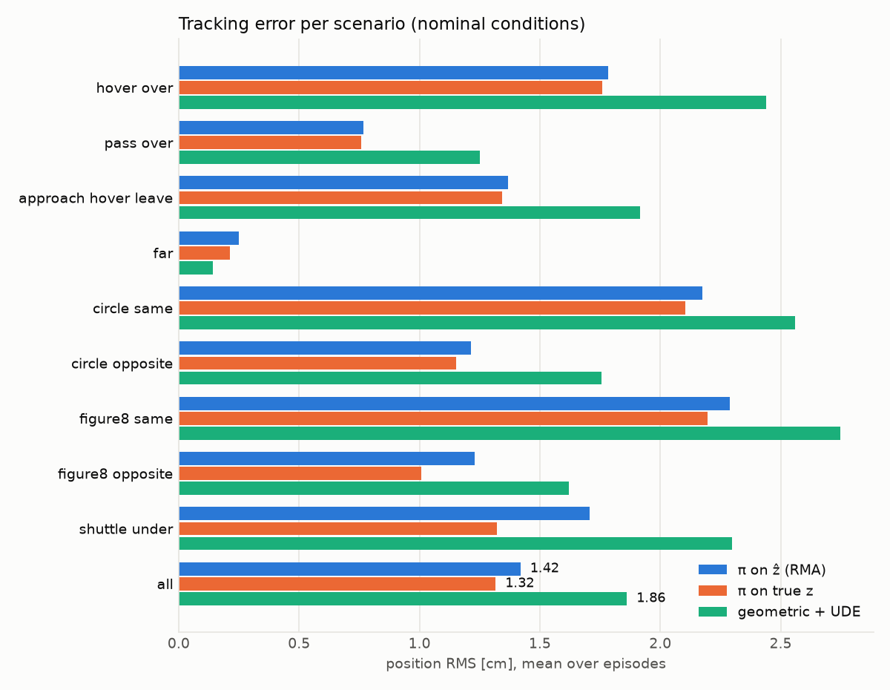
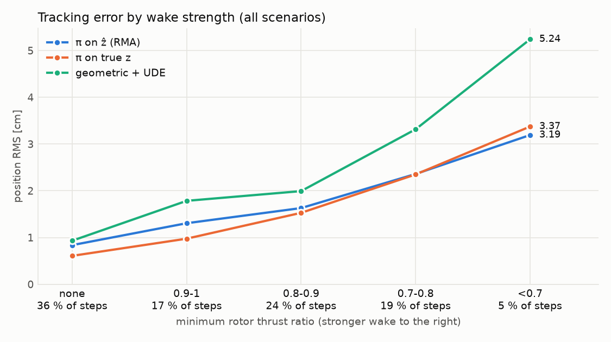
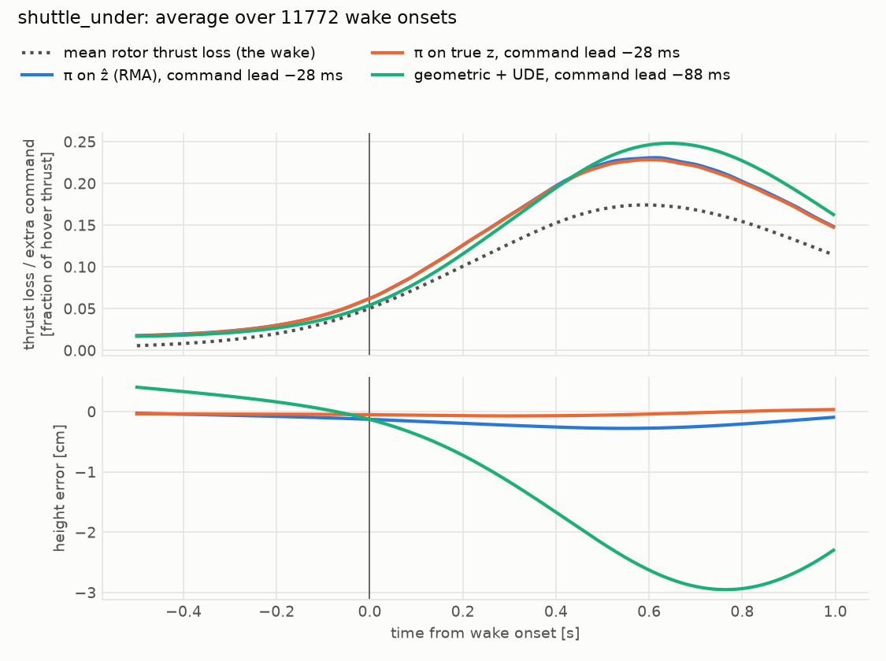
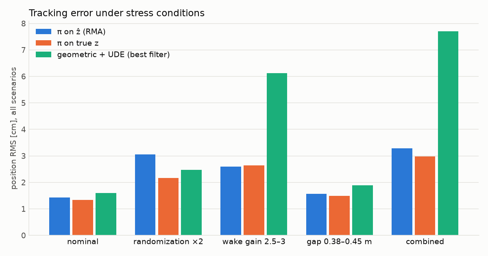

# Controller comparison: RMA policy vs geometric + UDE (`phase2_circles_3000`)

Evaluation of the bottom X650's controllers flying under the top X650's downwash, in
simulation. Branch `dev_enoch`, 2026-11-22. Checkpoint `runs/phase2_circles_3000` (Phase 1
`phase1_circles`, 2000 PPO iterations; Phase 2 φ, 3000 iterations). No rotor lag, no wake
transport delay, no sensor noise: the simulator settings the model was trained with.

## Summary

- **The RMA policy tracks 24 % better than geometric + UDE overall** (position RMS
  1.42 against 1.86 cm) and better in 8 of 9 scenarios. The exception is `far` (no
  downwash), where the UDE's integral-like action cancels the constant offsets exactly
  (0.14 against 0.25 cm).
- **The gap grows with the wake.** With no wake both are within 0.1 cm (0.84 / 0.93 cm);
  with more than 30 % thrust lost on a rotor, 3.19 against 5.24 cm. Under a wake stronger than
  any in training (gain 2.5–3.0, trained up to 2.0) the UDE's error is 2.4× the policy's (6.12 against 2.59 cm, best UDE
  filter), and 2.3× in the combined stress condition.
- **The policy reacts faster, it does not anticipate.** Averaged over wake onsets, its
  collective command follows the thrust loss by ~20 ms, the UDE's by ~80 ms; the UDE sags
  ~3 cm per crossing of the shuttle scenario, the policy ~0.3 cm. Peak error after a wake
  onset (p95): 3.95 against 6.22 cm.
- **Adaptation works.** φ's estimate recovers 96 % of the benefit of the true
  environment encoding (z = mean: 3.66 cm, ẑ: 1.42 cm, true z: 1.32 cm). Without z the same
  policy tracks 2.6–3.1× worse.
- **Where the UDE still wins:** a constant offset with no wake (`far`), yaw (0.07° against
  1.9°: the reward has no separate yaw term), action smoothness (|Δa| 0.0062 against 0.0094),
  and twice-wider parameter randomization (2.47 against 3.06 cm), where φ's identification
  extrapolates worst.
- **Real-time cost is negligible:** π 0.04 ms, φ 0.22 ms per call on one CPU core
  (budgets 4 ms and 8 ms).

## Setup

### Controllers

| name in tables | what it is | role |
|---|---|---|
| **π on ẑ** | RMA as deployed: φ estimates ẑ from the last 0.5 s of both drones' states and commands (125 Hz); π acts at 250 Hz on its tracking errors, the top drone's state and ẑ | the method |
| **π on true z** | the same π with z = μ(e_t) from the privileged environment factors | upper bound (perfect adaptation) |
| **π, z = 0** / **π, z = mean** | the same π with z set to zero / to its mean over the evaluation | does π use z? |
| **geometric + UDE** | Lee geometric controller on the nominal model + uncertainty-and-disturbance estimator (low-pass filtered model residual, force T = 0.1 s, torque T = 0.05 s) | non-learned baseline, own state and commands only |
| **geometric** | the same Lee controller without the estimator | reference: cost of not estimating |

The policies act deterministically (Gaussian mean). The UDE uses the default filter in
the nominal runs; the stress tests also sweep it (T = 0.03/0.02 to 0.2/0.1 s) and report
the best setting per condition.

### Scenarios

Both drones follow scripted reference paths; the top drone flies 0.5–2.0 m above.

| scenario | what happens | in training |
|---|---|---|
| hover_over | top drone holds above the hovering bottom drone (lateral offset 0–0.8 m, slow sway) | yes |
| pass_over | top drone crosses over at 0.4–1.0 m/s | yes |
| approach_hover_leave | top drone approaches, dwells 2–5 s, leaves | yes |
| far | top drone stays 4 m away (no downwash) | yes |
| circle_same / circle_opposite | both circle the same axis, same direction (continuous or partial overlap) or opposite (crossings) | yes |
| figure8_same / figure8_opposite | the same on a figure-8 | no |
| shuttle_under | top drone hovers; the bottom drone shuttles back and forth under it at up to 1–2 m/s | no |

Every episode also randomizes the bottom drone's mass (±15 %), inertia (±15 %), per-rotor
thrust (±10 %), CoM offset (±2 cm), a constant gust (±4 % of weight), and the wake's
strength (gain 0.8–2.0), spread, rotor solidity and airframe drag.

### Protocol

- 4096 parallel environments, one 15 s episode each, all 9 scenarios equally likely (435–480
  episodes per scenario), seed 0. Every controller flies the **same** episodes (paired).
- Tracking metrics skip the first 2 s (start transient from up to ±0.3 m initial offset);
  crashes and return cover the whole episode.
- Stress tests: 2048 environments, otherwise the same.

### Metrics

| metric | definition |
|---|---|
| position RMS | RMS of ‖p − p_ref‖ over an episode; mean (or p95) over episodes |
| worst error | max ‖p − p_ref‖ in an episode; p95 over episodes |
| crash | ground contact, flip, lost (> 3 m), or collision with the top drone's ellipsoid |
| closest approach (margin) | min over the episode of √((d_xy/1.03 m)² + (d_z/0.35 m)²) − 1; 0 = contact |
| wake bins | position RMS over the steps whose minimum rotor thrust ratio (thrust in the wake / in still air) falls in a bin |
| wake encounter | a span where the mean rotor thrust loss exceeds 2 % and reaches 5 % (gaps < 0.2 s merged); onset = first step above 5 % |
| onset / exit peak | max position error within 1 s after the onset / after the wake leaves |
| recovery | time from the wake leaving until the error stays below 1 cm for 0.25 s (share of encounters that recover in the episode) |
| lead | time between the 50 % rise of the collective command and of the thrust loss, averaged over onsets (> 0: the command rises first) |
| action rate | mean ‖a_t − a_{t−1}‖ per 4 ms step (normalized throttle) |
| ‖ẑ − z‖² | φ's estimation error, summed over the 8 latent dims (Var(z) ≈ 71) |

## Results

### Tracking per scenario (nominal conditions)



Position RMS [cm], mean over episodes (p95 over episodes in brackets for the three main
controllers):

| scenario | π on ẑ | π on true z | π, z = 0 | π, z = mean | geometric + UDE | geometric |
|---|---|---|---|---|---|---|
| hover_over | 1.78 (3.35) | 1.76 (3.24) | 4.16 | 3.73 | 2.44 (4.67) | 36.0 |
| pass_over | 0.77 (1.29) | 0.76 (1.33) | 4.28 | 3.43 | 1.25 (2.27) | 21.9 |
| approach_hover_leave | 1.37 (2.62) | 1.34 (2.59) | 4.54 | 3.79 | 1.92 (3.73) | 27.7 |
| far | 0.25 (0.47) | 0.21 (0.39) | 4.19 | 3.25 | **0.14** (0.23) | 18.0 |
| circle_same | 2.18 (3.68) | 2.10 (3.84) | 4.53 | 3.98 | 2.56 (4.91) | 34.2 |
| circle_opposite | 1.21 (2.03) | 1.15 (1.84) | 4.64 | 3.73 | 1.76 (2.85) | 20.7 |
| figure8_same (unseen) | 2.29 (3.87) | 2.20 (4.10) | 4.51 | 3.98 | 2.75 (4.98) | 35.2 |
| figure8_opposite (unseen) | 1.23 (1.98) | 1.01 (1.61) | 4.36 | 3.51 | 1.62 (2.78) | 21.4 |
| shuttle_under (unseen) | 1.71 (2.50) | 1.32 (2.07) | 4.40 | 3.60 | 2.30 (3.69) | 22.9 |
| **all** | **1.42 (3.00)** | 1.32 (2.97) | 4.40 | 3.66 | 1.86 (3.95) | 26.5 |

Worst error per episode, p95 over episodes, all scenarios: π on ẑ 6.86 cm, π on true z
7.07, geometric + UDE 8.62, geometric 67.2.

### Safety, smoothness and the other errors (all scenarios)

| | π on ẑ | π on true z | π, z = 0 | π, z = mean | geometric + UDE | geometric |
|---|---|---|---|---|---|---|
| crashes | 0 | 0 | 0 | 0 | 0 | 0.02 % (1 collision) |
| closest approach, p5 / min | 0.59 / 0.22 | 0.59 / 0.22 | 0.57 / 0.20 | 0.59 / 0.23 | 0.62 / 0.11 | 0.66 / 0.00 |
| velocity RMS [m/s] | 0.04 | 0.03 | 0.04 | 0.03 | 0.05 | 0.10 |
| body-rate RMS [rad/s] | 0.11 | 0.09 | 0.08 | 0.09 | 0.08 | 0.06 |
| tilt RMS [°] | 2.27 | 2.19 | 2.18 | 2.19 | 2.28 | 2.19 |
| yaw RMS [°] | 1.93 | 1.93 | 1.84 | 1.93 | **0.07** | 0.13 |
| action rate ‖Δa‖ | 0.0094 | 0.0090 | 0.0098 | 0.0090 | 0.0062 | 0.0044 |
| motor saturation | 0 % | 0 % | 0 % | 0 % | 0 % | 0 % |
| episode return (max 1500) | 1446 | 1450 | 1404 | 1415 | 1438 | 1098 |

- No learned controller and no UDE run crashes in nominal conditions.
- The closest approach hardly separates the controllers: it is set by the scripted paths.
  The UDE's slightly larger p5 margin comes from sagging away from the top drone.
- The ~2° tilt seen by every controller is the lean against the constant gust (up to
  4 % of weight), not an error.
- The policy holds a ~2° heading offset (the reward penalizes it only through the full
  attitude error), and its actions are ~50 % jerkier than the UDE's.

### Error by wake strength



Position RMS [cm] over the steps in each bin of the minimum rotor thrust ratio, all
scenarios:

| thrust ratio | share of steps | π on ẑ | π on true z | π, z = 0 | π, z = mean | geometric + UDE |
|---|---|---|---|---|---|---|
| no wake (≥ 0.999) | 35.9 % | 0.84 | 0.61 | 4.77 | 3.76 | 0.93 |
| 0.9–1 | 16.6 % | 1.31 | 0.98 | 4.68 | 3.79 | 1.78 |
| 0.8–0.9 | 23.6 % | 1.63 | 1.53 | 4.49 | 3.81 | 1.99 |
| 0.7–0.8 | 19.0 % | 2.36 | 2.35 | 4.79 | 4.25 | 3.32 |
| < 0.7 | 4.9 % | 3.19 | 3.37 | 5.27 | 4.80 | 5.24 |

The UDE's error grows about twice as fast with wake strength as the policy's. Out of the
wake, the policy on ẑ (0.84 cm) is behind the policy on the true z (0.61 cm): φ identifies
the drone's own parameters less well than the downwash.

### Wake encounters



All scenarios (4394–4399 encounters per controller; most come from circle_opposite,
figure8_opposite, shuttle_under, pass_over and approach_hover_leave):

| | π on ẑ | π on true z | π, z = 0 | π, z = mean | geometric + UDE | geometric |
|---|---|---|---|---|---|---|
| onset peak, mean / p95 [cm] | 2.02 / 3.95 | 2.07 / 4.30 | 5.06 / 9.10 | 4.29 / 7.67 | 3.53 / 6.22 | 27.8 / 50.4 |
| exit peak, mean / p95 [cm] | 1.85 / 3.72 | 1.44 / 3.33 | 4.85 / 8.82 | 4.01 / 7.25 | 2.81 / 4.97 | 27.8 / 51.3 |
| recovery [s] (share recovered) | 0.75 (90 %) | 0.29 (95 %) | 2.38 (5 %) | 1.78 (11 %) | 1.36 (63 %) | 1.45 (0 %) |
| lead of command over thrust loss [ms] | −24 | −20 | −32 | −32 | −80 | −208 |

Per scenario (onset peak p95 / exit peak p95 [cm], recovery [s], lead [ms]):

| scenario | π on ẑ | π on true z | geometric + UDE |
|---|---|---|---|
| pass_over | 2.4 / 1.9, 0.12 s, −32 | 2.9 / 1.4, 0.02 s, −32 | 4.8 / 4.4, 0.82 s, −48 |
| approach_hover_leave | 2.7 / 2.8, 0.21 s, −28 | 3.1 / 2.4, 0.09 s, −24 | 5.0 / 5.2, 0.93 s, −44 |
| circle_opposite | 3.8 / 3.4, 0.64 s, −20 | 4.2 / 3.5, 0.40 s, −16 | 6.2 / 4.8, 1.49 s, −88 |
| figure8_opposite | 4.0 / 3.4, 0.81 s, −20 | 4.2 / 3.4, 0.31 s, −20 | 6.4 / 4.7, 1.45 s, −84 |
| shuttle_under | 4.4 / 4.2, 1.29 s, −28 | 4.9 / 3.6, 0.36 s, −24 | 6.5 / 5.4, 1.98 s, −88 |

(hover_over, circle_same and figure8_same have the wake from the start, so they have few
onsets after the 2 s settle time; far has none.)

- Every controller's command **follows** the thrust loss (negative lead): none
  anticipates the wake, even though π sees the top drone's position. π responds ~60 ms
  sooner than the UDE, whose first-order filter needs ~T = 0.1 s to build its estimate.
- The figure (shuttle_under only, every env flying it) shows the consequence: the same
  thrust loss, a later and smaller command rise from the UDE, and a ~3 cm average sag
  against ~0.3 cm for the policy.
- φ costs recovery time: 0.75 s against 0.29 s with the true z (the error settles below
  1 cm more slowly after the wake leaves).

### Does the policy use z?

| | π, z = 0 | π, z = mean | π on ẑ | π on true z |
|---|---|---|---|---|
| position RMS, all [cm] | 4.40 | 3.66 | 1.42 | 1.32 |

- Replacing z triples the error, also out of the wake (`far`: 0.25 → 3.25–4.19 cm). π
  compensates the drone's own parameters and the gust through z; it has no integrator.
- φ closes 96 % of the gap between z = mean and the true z.
- φ's estimation error ‖ẑ − z‖² (Var(z) ≈ 71): 10.4 overall; 0.8 in `far`, 3.0 in
  `pass_over`, up to 19.6–21.0 on the unseen figure8_same and shuttle_under.

### Shuttle with and without downwash

The shuttle's fast reference is outside the training range, so part of its error is
tracking, not the wake. Same episodes with the downwash switched off:

| shuttle_under, position RMS [cm] | π on ẑ | π on true z | geometric + UDE |
|---|---|---|---|
| no downwash | 1.37 | 0.86 | 1.11 |
| with downwash | 1.71 | 1.32 | 2.30 |
| **cost of the wake** | **+0.34** | **+0.46** | **+1.19** |

Without downwash the UDE tracks the fast path better than π on ẑ, but the wake costs it
2.6–3.5× more. (π on ẑ without downwash is not a clean control: φ never saw a drone
overhead without its wake.)

### Stress conditions



One condition changed at a time, except `combined`. Survival % and position RMS [cm]
(mean, p95 over episodes), all scenarios; UDE = the best of four filter settings:

| condition | π on ẑ | π on true z | geometric + UDE (best T) |
|---|---|---|---|
| nominal | 100, 1.43 (3.05) | 100, 1.33 (3.00) | 100, 1.59 (3.43) (0.05/0.03 s) |
| randomization ×2 (mass and inertia ±30 %, motors ±20 %, CoM offset and gust ×2) | 99.95, 3.06 (6.78) | 100, 2.17 (5.25) | 100, **2.47** (7.18) (0.03/0.02 s) |
| wake gain 2.5–3.0 (training: 0.8–2.0) | 100, 2.59 (5.86) | 100, 2.64 (6.19) | 100, 6.12 (23.0) (0.03/0.02 s) |
| gap 0.38–0.45 m (training: 0.5–2.0) | 99.07, 1.57 (3.64) | 99.02, 1.49 (3.72) | 99.32, 1.89 (4.29) (0.03/0.02 s) |
| combined: gap 0.5–0.8 m, wake gain 2–3, randomization ×1.5 | 100, 3.28 (7.63) | 99.90, 2.97 (7.30) | 99.85, 7.70 (29.8) (0.03/0.02 s) |

Onset peak p95 [cm] (π on ẑ / geometric + UDE): nominal 4.0 / 4.5, randomization ×2
8.1 / 10.0, wake gain 6.6 / 17.5, gap 4.5 / 5.2, combined 8.1 / 23.9.

- Survival stays ≥ 99 % for all three everywhere; the small-gap losses are collisions on
  crossing paths for every controller (closest approach p5 0.07–0.11).
- A stronger wake is where the UDE breaks down (p95 23–30 cm), even with its fastest
  filter. The policy's error less than doubles.
- Wider parameter randomization is the one stress the UDE handles better than π on ẑ;
  π on the true z still wins (2.17 cm), so the loss is φ's identification, not π.
- The fastest UDE filter is best in every stressed condition. With sensor noise it would
  amplify noise (not modelled here).

### Compute cost

Batch-1 inference on one core of the lab PC (Intel i5-10600K), TorchScript, 5000 calls:

| | parameters | median | p99.9 | max | budget |
|---|---|---|---|---|---|
| π (every 4 ms) | 23.8 k | 0.04 ms | 0.08 ms | 0.11 ms | 4 ms |
| φ (every 8 ms) | 55.6 k | 0.22 ms | 0.35 ms | 0.40 ms | 8 ms |

Both fit their rates with a wide margin (worst case together ~0.5 ms, ~13 % of a 4 ms
tick); the end-to-end latency on the real stack is dominated by state estimation and ROS
transport (~12–24 ms measured on the X650), not by the networks.

## Caveats

- One trained model (one training seed) and one evaluation seed. Evaluation noise is small
  (435–480 paired episodes per scenario; the per-episode SD of the π − UDE difference is
  0.1–1.4 cm), but differences under ~10 % may not survive another training run.
- The simulator has no sensor noise, no state-estimation latency, no rotor lag and an
  instantaneous wake. Latency of 24 ms breaks both the policy (trained without it) and the
  UDE with these gains; that analysis and the retraining live on branch `dev_RMA`.
- The UDE gains (attitude k_R = 20, k_ω = 4) were tuned in a zero-delay simulator and are
  stiffer than the flight-tested X650 gains. Its filter was swept in the stress tests only.
- The downwash is an analytic jet model, not calibrated to flight data.

## Reproduce

From `code/` on `dev_enoch` (each 15 s rollout takes ~1 min regardless of env count):

```
PYTHONPATH=$PWD uv run python -m ProxQuad.scripts.evaluate --phase 2 --checkpoint runs/phase2_circles_3000/model.pt --ablate-z --plain-geometric --out runs/phase2_circles_3000/eval_report
PYTHONPATH=$PWD uv run python -m ProxQuad.scripts.evaluate --phase 2 --checkpoint runs/phase2_circles_3000/model.pt --scenarios shuttle_under --no-downwash --out runs/phase2_circles_3000/eval_report_shuttle_nodw
PYTHONPATH=$PWD uv run python -m ProxQuad.scripts.stress --checkpoint runs/phase2_circles_3000/model.pt --conditions nominal rand_x2 wake_gain_2.5-3 gap_0.38-0.45 combined
PYTHONPATH=$PWD uv run python ProxQuad/docs/figures/phase2_circles_3000/make_figures.py --onset
```

Run times: ~6.5 min, ~3 min, ~35 min, ~4 min. Per-scenario plots of every controller
(time series, median and worst episode, onset averages) are in
`runs/phase2_circles_3000/eval_report/` (not in git).
