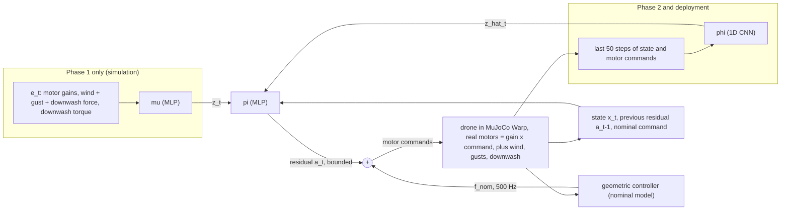

# Residual RMA (v2): a learned correction on top of a geometric controller

This folder is a second, independent version of our RMA pipeline. Edwin's first version
lives in `code/` and is untouched; nothing here imports or changes it, except that
`evaluate.py` and `render.py` can load his trained `code/rma.pt` to compare the two.

**One-line idea.** A classical geometric controller flies the drone. A small PPO policy adds
a bounded correction to each motor. The policy gets a short summary `z` of the current
disturbance (motor health, wind, another drone's downwash). In training, `z` comes from the
true disturbance values. When deployed, it comes from the last 0.5 s of flight data (RMA).

## Results

Each variant was trained once (seed 0) with `train_all.py` and evaluated with `evaluate.py`; every
method flies exactly the same scenarios. Lower is better except survival.

| | nominal only | v1 (Edwin's rma.pt) | end-to-end RMA, new env | residual, no z | **residual RMA (v2)** |
|---|---|---|---|---|---|
| tracking RMSE, calm | 0.0 cm | 3.7 cm | 3.5 cm | 0.5 cm | **0.7 cm** |
| tracking RMSE, v1's own ranges | 3.7 cm | 12.2 cm | 3.7 cm | 0.7 cm | **1.6 cm** |
| tracking RMSE, v2 training ranges | 8.9 cm | 37.2 cm | 4.8 cm | 1.8 cm | **4.1 cm** |
| survival at 2x the training ranges | 58% | 11% | 2% | 73% | **75%** |
| height lost, pass at 0.75 m | 3.2 cm | 1.3 cm | 2.5 cm | 0.3 cm | **0.3 cm** |
| height lost, pass at 0.25 m | 6.4 cm | 3.0 cm | 2.8 cm | 0.4 cm | **1.4 cm** |
| height lost, unseen pass at 0.15 m | 8.2 cm | 4.4 cm | 3.0 cm | 0.9 cm | **2.3 cm** |
| height lost, unseen 2x downwash at 0.25 m | 12.2 cm | 7.7 cm | 3.1 cm | 1.9 cm | **4.0 cm** |
| command jerk, v2 training ranges | 0.006 | 0.018 | 0.016 | 0.024 | **0.009** |

Control effort on the training ranges is about the same for every method (0.19 to 0.21).

Does `z` help? (the same trained policy, with three ways of getting `z`)

| | `z = mu(0)` (adaptation off) | `z_hat` from `phi` (deployable) | true `z` (best case) |
|---|---|---|---|
| residual: RMSE, v2 training ranges | 4.5 cm | 4.1 cm | 4.0 cm |
| residual: survival at 2x | 76% | 75% | 77% |
| residual: height lost, pass at 0.25 m | 1.4 cm | 1.4 cm | 1.4 cm |
| end-to-end: RMSE, v2 training ranges | | 4.8 cm | 4.0 cm |
| end-to-end: survival at 2x | | 2% | 11% |

Training (`logs/`, `results/training_curves.png`): both residual variants had no crashes from the
first iteration and were within 6 cm of the target by iteration 2. End-to-end crashed in most
episodes until about iteration 300 and first got within 6 cm at about iteration 590. All three runs
together, including Phase 2, took about 52 minutes on a MacBook CPU. Phase 2 ended with a `z` R^2
of 0.67 (residual) and 0.82 (end-to-end).

Full tables: `results/results.md`; every number is in `results/results.json`. Figures:
`results/summary.png`, `results/pass_trace.png`, `results/training_curves.png`. Videos:
`results/demo.mp4` is a stress test (motors and wind outside v1's training ranges);
`results/demo_v1range.mp4` stays inside v1's ranges.

What the numbers say:
* **The residual structure is what helps most.** Compared with the nominal controller alone,
  residual RMA halves the tracking error on the training ranges (8.9 to 4.1 cm), cuts the height
  lost under a 0.25 m pass from 6.4 to 1.4 cm, and survives 2x disturbances more often (58% to 75%).
  Without the controller (end-to-end), the same pipeline survives 2x disturbances only 2% of the
  time, and it needs about 300 iterations before it stops crashing.
* **Adaptation works, but `z` adds little on top of the residual.** `phi`'s estimate is almost as
  good as the true `z` (4.1 vs 4.0 cm), yet switching `z` off costs only 0.4 cm and changes nothing
  under passes. The controller's feedback already corrects most of what `z` describes. The
  diagnostic head agrees: from the history, `phi` recovers the motor gains with R^2 0.03 in the
  residual policy but 0.43 in the end-to-end policy, which has no controller and needs that
  information. Without the controller, `z` matters more: end-to-end loses accuracy (4.0 to 4.8 cm)
  and robustness (11% to 2%) when the true `z` is replaced by `phi`'s estimate.
* **The residual trained without `z` is the most accurate, but the least smooth.** It tracks to
  1.8 cm and loses only 0.4 cm under a pass, with similar survival (73%). Its motor commands
  change about 2.7x more from step to step than residual RMA's (jerk 0.024 vs 0.009), so it is
  trading smoothness for accuracy with a higher-gain behaviour. With one seed per variant, more
  seeds are needed before choosing between the two.
* **v1 is out of its training distribution in most of these tests.** v2's ranges are wider than
  v1's, so its drift on them (37 cm) is expected. On its own ranges it gets 12.2 cm, and under
  passes it does reasonably well (3.0 cm at 0.25 m vs 6.4 cm for the nominal). End-to-end retrained
  in the v2 environment gets 3.7 cm on v1's own ranges, so the v2 training setup (wider ranges, new
  reward, time-out bootstrapping, curriculum, 10 s episodes) helps even without the controller.

## Limitations
* One training seed per variant, so small differences between methods may be noise.
* Simulation only, hover only (no trajectory tracking).
* The downwash model is hand-tuned, not fitted to data. The intruder is scripted and does not feel
  our drone.
* The true mass and inertia equal the nominal ones, so all model error comes from the listed
  disturbances.

## What is in this folder

| file | what it does |
|---|---|
| `quadrotor.xml` | same 27 g Crazyflie-sized drone as v1, plus a visual-only "intruder" drone and a faint target cross |
| `controller.py` | nominal geometric SE(3) tracking controller (Lee et al. 2010) and motor mixer, batched in PyTorch |
| `disturbances.py` | motor gains, steady wind, gusts, and the overhead-pass downwash model |
| `env.py` | `ResidualQuadEnv`: thousands of drones in parallel with MuJoCo Warp, residual or end-to-end actions |
| `policy.py` | encoder `mu`, base policy `pi` (actor-critic) and adaptation module `phi` (same layout as v1) |
| `train.py` | Phase 1 (PPO with privileged `e_t`) and Phase 2 (supervised `phi`), writes `checkpoints/` and `logs/` |
| `train_all.py` | trains all three variants in parallel with one command, with a status line every minute |
| `evaluate.py` | runs every method on the same test scenarios, writes `results/results.json` and `results/results.md` |
| `plots.py` | the figures in `results/` |
| `render.py` | side-by-side video of several methods in the same scenario (`results/demo.mp4`, `.gif`) |
| `play.py` | interactive viewer: send a drone overhead, break a motor, switch the residual off, push the drone |
| `checkpoints/` | the trained models used for the results above |
| `logs/` | training curves as CSV (one row per iteration) |

## How to run it

```bash
pip install -r residual_rma/requirements.txt
cd residual_rma

# watch the trained drone (Mac: use mjpython, which comes with the mujoco package)
mjpython play.py                      # P = overhead pass, G = new motor gains, M = residual on/off

# reproduce the results
python evaluate.py                    # 10 to 20 min on a laptop CPU
python plots.py
python render.py                      # on a headless Linux box: xvfb-run -a python render.py

# retrain all three variants in parallel (about 50 min on a MacBook CPU, faster on a CUDA GPU)
python train_all.py --smoke           # 1-2 min speed test with a time estimate
python train_all.py                   # res_z, res_noz and e2e_z

# or one variant at a time
python train.py --phase all --mode residual --name res_z                 # the main method
python train.py --phase 1   --mode residual --no-z --name res_noz        # ablation: no z
python train.py --phase all --mode e2e --name e2e_z --iters 800          # ablation: no nominal controller
```

## Design



### 1. Nominal controller (`controller.py`)

A geometric tracking controller on SE(3) (Lee, Leok and McClamroch, 2010), the standard
controller for quadrotors. It knows only the nominal model: 27 g, nominal inertia, four
identical motors, no wind. It computes a desired force from position and velocity errors,
turns that into a desired attitude, then computes body torques. A mixer splits the thrust
and torques into four motor thrusts. Gains: position loop about 5 rad/s, attitude loop about
25 rad/s, tilt limit 35 degrees. It has no integral term, so a constant push leaves a constant
offset (offset = force / kp). That is a typical weakness for the residual to fix.

It runs at 500 Hz (every physics step), as on a real Crazyflie. The policy runs at 100 Hz.

### 2. Action: a bounded residual (`env.py`)

```
motor command_i = f_nom,i + 0.5 * hover_thrust * a_i        a_i in [-1, 1]
actual thrust_i = gain_i * clamp(motor command_i, 0, 0.15 N)
```

The residual can change each motor by at most 50% of hover thrust. The actor's last layer
starts near zero, so training starts from a drone that already flies (the nominal
controller alone). For the ablation `--mode e2e` the nominal is removed and
`motor command = hover * (1 + a)`, which is exactly v1's action.

### 3. Environment factors (`disturbances.py`)

All ranges are multiplied by a scale `s` (curriculum 0.3 to 1 during training; tests use 1 and 2).

| factor | model | training range (s = 1) | when it changes |
|---|---|---|---|
| motor gains | each motor gives gain_i x command | 0.8 to 1.2, independent per motor | each episode, and re-drawn mid-flight with prob. 0.004 per step |
| steady wind | constant force | +-0.05 N per axis (weight is 0.26 N) | same as gains |
| gusts | Ornstein-Uhlenbeck force, time constant 0.5 s | std 0.02 N per axis | every step |
| overhead pass | a second drone flies a 2 m straight line over the target | 60% of episodes; height 0.25 to 0.75 m above, speed 0.2 to 0.5 m/s, random heading, miss distance up to 0.15 m, start time 0 to 3 s | each episode |

**Downwash model.** The jet under the other drone is a Gaussian in horizontal distance, with
peak force `0.30 x weight x (0.25 / dz)` and width `0.04 + 0.15 dz` metres. That is about
30% / 15% / 10% of the drone's weight at 0.25 / 0.5 / 0.75 m below. The force is applied on
each of the four rotor discs separately, so an off-centre jet also tilts the drone. These
numbers are chosen to be plausible; they are not fitted to measurements, and that is
the first thing to replace if we get real data. Ground effect is left out: at 1 m altitude a
Crazyflie-sized rotor is about 20 rotor radii above the floor, where ground effect is
negligible.

### 4. What the networks see

| | contents | size |
|---|---|---|
| observation `x_t` | position error, rotation matrix, linear velocity, body rates, nominal command / hover - 1, previous residual | 26 |
| privileged `e_t` | (gain - 1) / 0.2, total external force / 0.1 N, external torque / 1e-3 N m | 10 |
| history entry for `phi` | the 18 state values before the step + the mean total motor command over the step / hover - 1 | 22 |

`phi` sees the **total** motor command (nominal + residual), because that is what the motors
actually received. That is what lets it work out "I asked for X and the drone did Y".

### 5. Reward

```
r = exp(-|pos error| / 0.2) - 0.02 |body rates| - 0.05 |a|^2 - 0.01 |a - a_prev| - 10 * crashed
```

* `exp(-e/0.2)` is 1 at the target and fades out by about 0.6 m, so the policy keeps
  getting a useful signal down to the last centimetre (v1's `1 - |e|` is flat near 0).
* `|a|^2` charges for using the residual, so the policy only corrects when it helps.
* Crash: below 5 cm, tilted past about 78 degrees, or more than 3 m away. Episodes are 10 s.
  **Time-outs are not treated as crashes**: the return is bootstrapped with the critic's
  value, so the critic does not learn that "the world ends at 10 s".

### 6. Training (`train.py`)

* Phase 1: PPO, 2048 drones in parallel, 24-step rollouts, 5 epochs x 4 minibatches,
  gamma 0.99, lambda 0.95, clip 0.2, lr 3e-4, running observation normalisation.
  `pi` and `mu` are trained together through the PPO loss (as in the RMA paper).
  The episode clocks start spread out so that resets do not happen all at once.
* Phase 2: `pi` and `mu` frozen. The drones fly with `z_hat = phi(history)` (on-policy, as in
  RMA), and `phi` regresses `mu(e_t)` with MSE. `phi` updates every step (100 Hz) instead of
  v1's 10 Hz, because a pass lasts well under a second.
  A small extra head on `phi` predicts `e_t` itself from the same features (detached), only as
  a diagnostic: it tells us which disturbances are visible in the history.

### 7. Evaluation (`evaluate.py`)

Every method flies exactly the same random draws. Crashed drones are not reset, so the
random stream stays identical across methods.

* Scenarios: calm; v1's ranges (s = 0.5, no passes); training ranges (s = 1); 2x training
  ranges; single overhead passes at 0.75 / 0.5 / 0.25 m (the drone starts on target, no other
  disturbance); and two unseen cases: a pass at 0.15 m and a pass at 0.25 m with twice the
  downwash.
* Metrics: survival rate, position RMSE (after the first second), largest height loss during
  a pass, control effort (RMS of motor command / hover - 1), command smoothness
  (mean absolute change of command per step), `z` error of `phi`, and R^2 of `phi`'s `e_t` guess.
* Methods: nominal only; residual without `z`; residual with `z = mu(0)`; residual with the
  true `z`; **residual RMA**; end-to-end RMA retrained in this environment; Edwin's v1 `rma.pt`.

## How v2 differs from v1

| | v1 (`code/`, Edwin) | v2 (`residual_rma/`, this folder) |
|---|---|---|
| who flies the drone | the policy alone: `thrust = hover (1 + a)` | geometric controller + bounded learned residual |
| starting point of training | random policy, crashes for the first ~150 iterations | flies from iteration 0 (residual starts at zero) |
| environment factors | motor gains +-10%, one constant force +-0.02 N | gains +-20%, wind +-0.05 N, OU gusts, overhead pass with a rotor-level downwash model |
| `e_t` | 7 (gains, constant force) | 10 (gains, total force, torque) |
| observation | 22 | 26 (adds the nominal command) |
| history for `phi` | state + policy action | state + total motor command |
| reward | 1 - \|e\| - 0.05 \|w\| - 0.01 \|da\| | exp(-\|e\|/0.2) - 0.02 \|w\| - 0.05 \|a\|^2 - 0.01 \|da\| - 10 crash |
| time-outs | treated as terminations | bootstrapped (not a failure) |
| episode | 5 s | 10 s, staggered starts |
| curriculum | none | disturbance scale 0.3 to 1 over the first third |
| `phi` rate | 10 Hz | 100 Hz |
| evaluation | success, time-to-fall, position error, return, z MSE | adds RMSE, height loss under passes, effort, smoothness, unseen cases, and every method on identical draws |
| networks | MLP 128-128, encoder 256-128, CNN adaptation | same sizes, actor's last layer initialised near zero |


